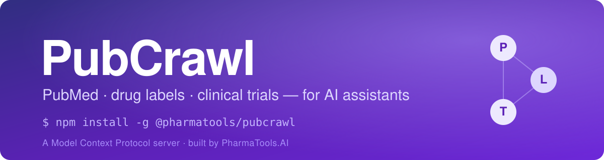

<div align="center">



<h1></h1>

**An [MCP server](https://modelcontextprotocol.io) that gives AI assistants access to PubMed, Europe PMC, FDA & UK drug labelling, and ClinicalTrials.gov.**

_A peer-reviewed pub crawl through the literature — the label — and the trial._

[](https://github.com/nickjlamb/pubcrawl/actions/workflows/build.yml)
[](https://www.npmjs.com/package/@pharmatools/pubcrawl)
[](https://www.npmjs.com/package/@pharmatools/pubcrawl)
[](https://nodejs.org)
[](https://registry.modelcontextprotocol.io/?q=pubcrawl)
[](https://glama.ai/mcp/servers/nickjlamb/pubcrawl)
[](https://mcpservers.org/servers/nickjlamb/pubcrawl)
[](https://doi.org/10.5281/zenodo.22101559)
[](LICENSE)
[](CONTRIBUTING.md)

[Quick start](#-quick-start-60-seconds) · [Tools](#-tools) · [Examples](#-examples) · [Architecture](#-architecture) · [Self-hosting](#-run-in-your-own-environment) · [Roadmap](ROADMAP.md) · [Contributing](CONTRIBUTING.md)

</div>

---

## ✨ What is PubCrawl?

PubCrawl connects your AI assistant (Claude Desktop, Cursor, or any MCP-compatible client) directly to the primary sources clinicians and researchers actually use — so you can ask a question in plain English and get an answer grounded in **PubMed**, **Europe PMC**, **FDA/UK drug labelling**, and **ClinicalTrials.gov**, with real PMIDs, NCT IDs, and DOIs you can verify.

Every tool is a thin, deterministic wrapper over an official API. Nothing is invented; every result cites its source.

### The thing no other MCP server does

Ask **"compare US and UK labelling for semaglutide"** and PubCrawl pulls both live labels and maps equivalent sections — US *Indications and Usage* ↔ UK *4.1 Therapeutic indications*, and so on — so the differences are visible instead of assumed:


| | US Prescribing Information | UK SmPC |
|---|---|---|
| **Indications** | glycaemic control · **reduce risk of MACE** in T2D with established CVD · **reduce risk of sustained eGFR decline, ESKD and CV death** in T2D with CKD | glycaemic control only — CV and renal outcomes appear as cross-references to §4.4/4.5/5.1, *not* as indications |
| **Contraindications** | personal or family history of MTC or MEN 2 · hypersensitivity | hypersensitivity only |

A cardiovascular claim that is on-label in the US promotes an unlicensed indication in the UK. If you write, review, or check medical copy for both markets, that gap is the whole job — and `compare_labels` is the only MCP tool that surfaces it.

### Everything else

- 🔬 **14 tools** across literature, drug labelling, and clinical trials
- 🧾 **Verifiable by design** — results link back to DailyMed, the eMC, PubMed, and ClinicalTrials.gov
- 📰 **Preprints** via Europe PMC — surface work ahead of formal publication
- 🆓 **No API keys required** (an optional free NCBI key raises PubMed rate limits)
- 🧪 Fully **typed, tested, and CI-checked** — literature retrieval gated by [OpenGATE](https://github.com/nickjlamb/opengate), and labelling & trials by the in-repo [fidelity benchmark](benchmark/README.md), on every release

Built by [PharmaTools.AI](https://pharmatools.ai).

---

## 🚀 Quick start (60 seconds)

**1. Add PubCrawl to your client config** — no install step needed, `npx` fetches it on first run.

For **Claude Desktop**, edit `claude_desktop_config.json`:

- **macOS:** `~/Library/Application Support/Claude/claude_desktop_config.json`
- **Windows:** `%APPDATA%\Claude\claude_desktop_config.json`

```json
{
  "mcpServers": {
    "pubcrawl": {
      "command": "npx",
      "args": ["-y", "@pharmatools/pubcrawl"]
    }
  }
}
```

**2. Restart your client.** PubCrawl appears under **+ → Connectors**.

**3. Ask away:**

> _"Compare the US and UK labelling for atorvastatin, and find recent Phase 3 trials for it."_

That's it. → [More examples](#-examples) · [API key & other options](#-configuration)

---

## 🧰 Tools

### 📚 Literature

| Tool | What it does |
|------|-------------|
| `search_pubmed` | Search PubMed with filters for date range, article type, and sort order. Returns PMIDs, titles, authors, journals, and DOIs. |
| `search_europepmc` | Search Europe PMC — a broader corpus than PubMed that also indexes preprints (bioRxiv, medRxiv) and patents. Each result includes an abstract snippet, citation count, open-access status, and a preprint flag. Filter to preprints or open-access only. |
| `get_abstract` | Get the full structured abstract for an article — broken into labeled sections (background, methods, results, conclusions) with keywords and MeSH terms. |
| `get_full_text` | Retrieve the full text of open-access articles from PubMed Central, with parsed sections, figure/table captions, and reference counts. |
| `find_related` | Find similar articles using PubMed's neighbor algorithm, ranked by relevance score. |
| `format_citation` | Generate a formatted citation in APA, Vancouver, Harvard, or BibTeX style. |
| `trending_papers` | Find recent papers on a topic, with optional filtering to high-impact journals (Nature, Science, Cell, NEJM, Lancet, JAMA, etc.). |

### 💊 Drug labelling

| Tool | What it does |
|------|-------------|
| `resolve_drug_name` | Convert a brand drug name to its generic (or a generic to its US brand names), with drug class and common indications. Deterministic, via RxNorm/openFDA — no AI. |
| `get_uspi` | Pull US Prescribing Information sections via openFDA (cited to DailyMed) — indications, dosing, warnings, contraindications, and more. |
| `get_smpc` | Retrieve UK Summary of Product Characteristics from the eMC — the UK equivalent of US prescribing information, with numbered SmPC sections. |
| `compare_labels` | Side-by-side comparison of US (USPI) and UK (SmPC) labelling for the same drug, pairing equivalent sections (US Indications ↔ UK 4.1). A missing side is always explained, cut sections are flagged `truncated`, and `us_drug` / `uk_drug` pin a different name per market (Farxiga / Forxiga). |
| `search_by_indication` | Find drugs approved for a medical condition. Searches FDA labelling via openFDA, then cross-references UK availability on the eMC. |

### 🧫 Clinical trials

| Tool | What it does |
|------|-------------|
| `search_trials` | Search ClinicalTrials.gov for clinical trials. Filter by condition, intervention, recruitment status, and phase. Returns NCT IDs, sponsors, enrollment, and links. |
| `get_trial` | Get full details for a clinical trial by NCT ID — eligibility criteria, study design, arms, primary/secondary outcomes, locations, and associated PubMed IDs. |

---

## 💬 Examples

Once connected, just ask naturally:

**Literature**
- "Search PubMed for recent clinical trials on semaglutide."
- "Search Europe PMC for preprints on GLP-1 receptor agonists, most cited first."
- "Get the abstract for PMID 38127654, then find related papers and cite them all in Vancouver style."
- "What are the trending papers on CRISPR gene therapy this month, high-impact journals only?"
- "Pull the full text of that PMC article and summarise the methods section."

**Drug labelling**
- "Get the FDA prescribing information for metformin — just the indications and warnings."
- "Pull the UK SmPC for atorvastatin."
- "Compare US and UK labelling for lisinopril and highlight the differences."
- "What's the generic name and drug class for Ozempic?"
- "What drugs are approved for type 2 diabetes in both the US and UK?"

**Clinical trials**
- "Find recruiting Phase 3 trials for pembrolizumab in breast cancer."
- "Get the eligibility criteria and primary outcomes for NCT03086486."

**Cross-source (where PubCrawl shines)**
- "For semaglutide: summarise the US label's cardiovascular indication, then find the pivotal trial and its NEJM publication."

---

## 🏗 Architecture

Three layers — **tools** register the MCP interface, **lib clients** talk to each external API, and shared **cache** + **parsers** keep it fast and consistent.

<picture>
  <source media="(prefers-color-scheme: dark)" srcset="docs/architecture-dark.svg">
  
</picture>

Each tool file exports a `register*Tool(server)` function with a zod schema and an async handler. All network calls are rate-limited, cached, and time-bounded. See [`CLAUDE.md`](CLAUDE.md) for a full architecture walkthrough and [`CONTRIBUTING.md`](CONTRIBUTING.md) to add a tool.

---

## 🔧 Configuration

### Install options

```bash
# Zero-install (recommended): npx fetches it on demand — see Quick start above.

# Or install globally:
npm install -g @pharmatools/pubcrawl

# Config for a global install:
#   { "mcpServers": { "pubcrawl": { "command": "pubcrawl" } } }
```

### NCBI API key (optional)

Without a key, PubMed requests are limited to 3/second. A free key raises this to 10/second.

1. Create a free NCBI account at <https://www.ncbi.nlm.nih.gov/account/>
2. Account Settings → API Key Management → create a key
3. Add it to your config:

```json
{
  "mcpServers": {
    "pubcrawl": {
      "command": "npx",
      "args": ["-y", "@pharmatools/pubcrawl"],
      "env": { "NCBI_API_KEY": "your_key_here" }
    }
  }
}
```

### HTTP transport

PubCrawl also ships a stateless Streamable HTTP transport for hosted and browser-based clients:

```bash
npm run start:http   # serves POST /mcp and GET /health on PORT (default 3000)
```

---

## 🏢 Run in your own environment

For teams who need PubCrawl inside their own cloud project rather than on a laptop, it runs as a container serving MCP over Streamable HTTP. Each request is handled by a fresh server instance with no sessions, so it scales horizontally behind any load balancer.

```bash
docker build -t pubcrawl .
docker run --rm -p 8080:8080 pubcrawl
curl http://localhost:8080/health   # {"status":"ok","server":"pubcrawl","version":"…"}
```

Point any MCP client, or an agent registry such as Google Cloud Agent Registry, Microsoft Foundry or Amazon Bedrock AgentCore, at `https://<your-host>/mcp`. Authentication is left to the platform in front of the container (Cloud Run IAM, API Gateway, an identity-aware proxy), so PubCrawl itself holds no credentials for your users.

The image runs as a non-root user, has a container health check, and shuts down cleanly on `SIGTERM`. CI builds it on every push and checks the health endpoint, the MCP handshake, the full tool list and a clean stop.

### Google Cloud Run and Agent Registry

These steps were run end to end in November 2026. Replace `PROJECT_ID` and `REGION`; the project needs billing and the `run`, `cloudbuild`, `artifactregistry` and `agentregistry` APIs enabled.

**1. Deploy behind Cloud Run IAM.** From a clone of this repo (the `--functional-type` flag needs a current `gcloud` with the beta component):

```bash
gcloud beta run deploy pubcrawl --source . --project=PROJECT_ID --region=REGION \
  --no-allow-unauthenticated --functional-type=mcp-server --max-instances=2
```

Unauthenticated requests to any path now get `403` from Google before reaching PubCrawl. With an identity token, `/health` answers as usual:

```bash
URL=$(gcloud run services describe pubcrawl --project=PROJECT_ID --region=REGION --format='value(status.url)')
curl -H "Authorization: Bearer $(gcloud auth print-identity-token)" $URL/health
```

**2. Register the endpoint and its tools.** `--functional-type=mcp-server` adds an entry to Agent Registry that links to the Cloud Run service, but it carries no endpoint URL and no tools, because the registry can't read tools from a server that requires authentication. Register the endpoint manually with the tool spec in [`deploy/agent-registry/toolspec.json`](deploy/agent-registry/toolspec.json):

```bash
gcloud agent-registry services create pubcrawl-mcp --project=PROJECT_ID --location=REGION \
  --display-name="PubCrawl" \
  --mcp-server-spec-type=tool-spec \
  --mcp-server-spec-content=deploy/agent-registry/toolspec.json \
  --interfaces=url=$URL/mcp,protocolBinding=jsonrpc
```

After a minute or so, `gcloud agent-registry mcp-servers list --project=PROJECT_ID --location=REGION` shows `PubCrawl` with its `/mcp` URL and all 14 tools.

The tool spec is generated from the server itself (`npm run build && npm run toolspec`), and a test fails if the committed file falls out of step with the code. The registry requires an input schema for every tool and caps the spec at 10 KB, so the schemas keep their types, required fields, enums, defaults and ranges but drop parameter descriptions. Clients that connect still get the complete schemas from the server.

**3. Connect a client.** Any client that can send a header can call the service with a Google identity token. With Claude Code:

```bash
claude mcp add --transport http pubcrawl-gcp $URL/mcp \
  --header "Authorization: Bearer $(gcloud auth print-identity-token)"
```

The token expires after an hour and is stored in the client's config, so this suits a quick test; remove it afterwards with `claude mcp remove pubcrawl-gcp`. For everyday use, `gcloud run services proxy pubcrawl --project=PROJECT_ID --region=REGION --port=3000` keeps refreshing your credentials, and the client connects to `http://localhost:3000/mcp` with no header. The proxy needs the `cloud-run-proxy` gcloud component. In our test it reported the binary as missing straight after installing it; the header route above works without it.

Agents running in Google Cloud should call the service as their own service account, granted `roles/run.invoker` on it, rather than with a user's token.

### Environment variables

| Variable | Default | Purpose |
|---|---|---|
| `PORT` | `8080` in the image, `3000` otherwise | Port to listen on. Cloud Run and most platforms set this. |
| `HOST` | `0.0.0.0` | Interface to bind. |
| `NCBI_API_KEY` | none | Raises PubMed's limit from 3 to 10 requests per second. |
| `PUBCRAWL_ALLOWED_ORIGINS` | `*` | Comma-separated browser origins allowed to call the server. When set, requests from any other origin are refused with 403. Requests with no `Origin` header, such as server-side agents, are unaffected. |

### Network egress

PubCrawl needs outbound HTTPS to these hosts only, which is the complete list for a firewall allowlist:

| Host | Used for |
|---|---|
| `eutils.ncbi.nlm.nih.gov` | PubMed and PubMed Central (search, abstracts, full text, related articles, citations) |
| `www.ebi.ac.uk` | Europe PMC |
| `clinicaltrials.gov` | ClinicalTrials.gov API v2 |
| `api.fda.gov` | US prescribing information (openFDA) |
| `rxnav.nlm.nih.gov` | US/UK drug-name resolution (RxNorm) |
| `www.medicines.org.uk` | UK Summaries of Product Characteristics (eMC) |

### Data handling

- **What leaves your environment:** the search terms, identifiers and drug names in each tool call are sent to the public source that answers it, from the table above. Nothing goes anywhere else, and PharmaTools.AI receives nothing.
- **What is kept:** upstream responses are held in an in-memory cache (500 entries, up to 24 hours) to stay within the sources' rate limits. Nothing is written to disk, and the cache is gone when the instance stops.
- **What is logged:** one line at startup and one at shutdown. Requests and queries are not logged.
- **Identification to NCBI:** per NCBI's usage policy, E-utilities requests identify the tool as `pubcrawl` with the maintainer's contact address.
- **No model in the path:** every tool is a deterministic API call and parse. Nothing is generated.

---

## 🗺 Roadmap

Highlights of what's planned — see [`ROADMAP.md`](ROADMAP.md) for the full list.

- `get_europepmc_fulltext` — read preprints & OA articles surfaced by `search_europepmc`
- `get_adverse_events` — openFDA FAERS adverse-event lookups
- EMA / EPAR labelling to complement the US + UK `compare_labels`
- MeSH query helper for sharper PubMed searches
- MCP **resources** & **prompts** for common review workflows

Ideas welcome — [open an issue](https://github.com/nickjlamb/pubcrawl/issues/new/choose).

---

## 🛠 Development

```bash
git clone https://github.com/nickjlamb/pubcrawl.git
cd pubcrawl
npm install

npm run dev      # TypeScript watch mode
npm run build    # compile to dist/
npm start        # run the stdio server
npm test         # Vitest unit suite
npm run lint     # ESLint
```

Unit tests live in `tests/` and cover the parsing, caching, citation, formatting and label-pairing logic with fixture payloads (no network calls). CI runs lint → test → build on every push and pull request. New to the codebase? Start with [`CONTRIBUTING.md`](CONTRIBUTING.md).

### Measuring fidelity

```bash
npm run bench            # labelling + trials fidelity benchmark against the live sources
npm run bench -- --ci    # what the release gate runs: exit 1 if a verified case fails
```

Two gates run on every release and weekly. [OpenGATE](https://github.com/nickjlamb/opengate)'s retrieval scorer checks PubMed and Europe PMC records against hand-verified anchors. The in-repo [fidelity benchmark](benchmark/README.md) does the same for drug labelling and trials: `compare_labels` is held to a gold set of US/UK anchors (a phrase must appear on one side and must *not* on the other, so real divergences are surfaced rather than smoothed over) plus a verbatim check that refetches the raw openFDA record and eMC page and confirms every returned sentence is a substring of the source. No LLM judge anywhere in either gate.

---

## 📦 Releases & changelog

Versions follow [Semantic Versioning](https://semver.org). See the [**CHANGELOG**](CHANGELOG.md) for a full history and [Releases](https://github.com/nickjlamb/pubcrawl/releases) for notes and assets.

## 🤝 Contributing

Contributions are welcome and appreciated — bug reports, new data sources, new tools. Read the [contributing guide](CONTRIBUTING.md) to get started, then [open an issue](https://github.com/nickjlamb/pubcrawl/issues/new/choose) or a pull request.

## 📚 Citation

If PubCrawl supports work you publish, please cite it — see [`CITATION.cff`](CITATION.cff), or:

```bibtex
@software{lamb_pubcrawl,
  author    = {Lamb, Nick},
  title     = {PubCrawl: verifiable biomedical literature, drug labelling and clinical trials for AI assistants},
  year      = {2026},
  publisher = {Zenodo},
  doi       = {10.5281/zenodo.22101559},
  url       = {https://doi.org/10.5281/zenodo.22101559}
}
```

---

## 📄 License

[MIT](LICENSE) © [PharmaTools.AI](https://pharmatools.ai)

<div align="center">
<sub>Data from NCBI E-utilities, Europe PMC, openFDA, DailyMed, the UK eMC, and ClinicalTrials.gov. PubCrawl is not affiliated with these providers.</sub>
</div>
